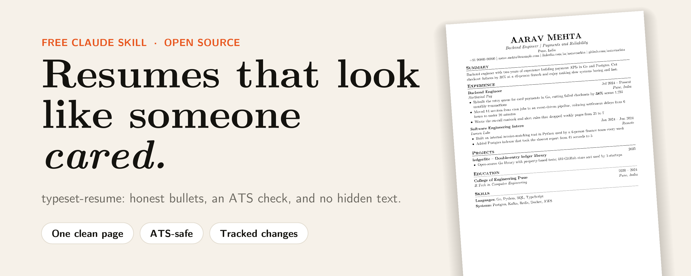
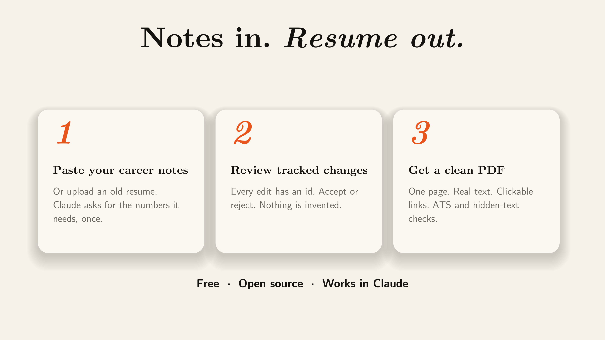
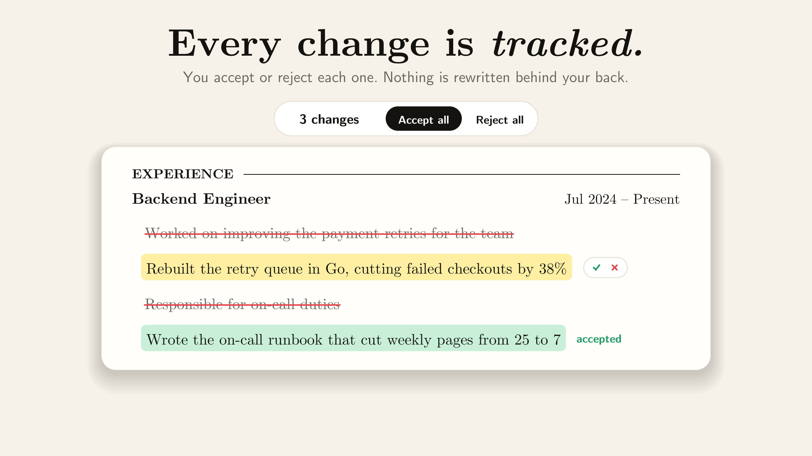
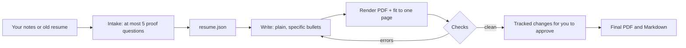
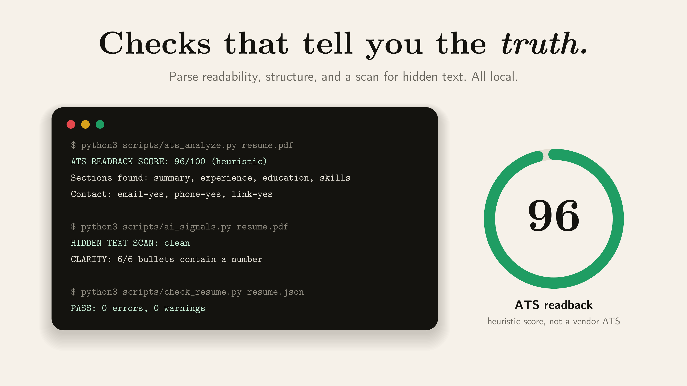

<div align="center">



# typeset-resume

**A free Claude skill that turns career notes into an honest, ATS-safe, beautifully typeset one-page resume.**

One design. Real text. Tracked changes. Checks that tell you the truth.

[](LICENSE)
[](#install)
[](#requirements)
[](typeset-resume/assets/fonts/OFL.txt)

[Install](#install) · [Try it](#try-these-prompts) · [How it works](#how-it-works) · [ATS check](#the-ats-analyzer) · [Will AI pick yours?](#will-ai-pick-yours) · [CLI](#command-line) · [FAQ](#faq)

</div>

---

## Why this exists

Most resume tools give you fifty templates and a pile of adjectives. The result looks like everyone else's, reads like a press release, and you never learn what software actually sees.

`typeset-resume` does the opposite:

| Instead of | You get |
|---|---|
| Fifty templates | **One** quiet, classic page in Computer Modern |
| "Spearheaded transformative solutions" | Plain, specific bullets that lead with proof |
| Guessing what an ATS reads | A **parser view** and a readability score |
| Silent AI rewrites | **Tracked changes** with ids you accept or reject |
| Hidden-text templates | A **hidden-text scan** so nothing risky ships by accident |

## What you get



- **A one-page PDF** with real selectable text, clickable links (email, phone, LinkedIn, GitHub) and embedded fonts. A4 or US Letter.
- **Honest bullets.** It never invents an employer, date, tool or number. If a number would help, it asks you.
- **Tracked changes.** When it edits an existing resume you see the old line, the new line and a reason. Accept or reject by id.
- **An ATS analyzer** for *any* resume PDF, with a transparent score.
- **Job tailoring** that reorders your real evidence and shows which requirements you have no proof for yet.
- **A Markdown export** of the same resume.



## Install

**Claude.ai** (easiest)

1. Download [`dist/typeset-resume.skill`](dist/typeset-resume.skill) (or grab it from the latest [Release](../../releases)).
2. In Claude, open **Settings**, find **Skills**, and upload the file.
3. Start a chat and attach or paste your resume or career notes.

**Claude Code**

```bash
git clone https://github.com/YOUR-USERNAME/typeset-resume.git
cp -r typeset-resume/typeset-resume ~/.claude/skills/
```

### Requirements

Python 3.9+, plus `reportlab` (PDF), `pdfplumber` and `pypdf` (analysis). If an import fails: `pip install reportlab pdfplumber pypdf`. Poppler's `pdftotext` is used for extra checks when present.

## Try these prompts

| Say | What happens |
|---|---|
| *"Here is my old resume. Make it one page and fix the weak bullets."* | Rewrites with tracked changes, renders the PDF |
| *"Tailor my resume to this job."* (paste it) | Reorders evidence, lists requirements you cannot yet prove |
| *"Will this resume pass an ATS?"* (attach a PDF) | Parser view, issues, score |
| *"Will AI pick my resume for this job?"* | Hidden-text scan, then a screener simulation |
| *"Add a Skills section and a Writing section."* | Adds sections from facts you gave |
| *"I have no experience yet."* | Builds from projects and college work |

## How it works



1. **Intake.** Reads what you gave it and asks, once, for the numbers it needs (users, speed, scale, results).
2. **Structure.** Builds a `resume.json`: an ordered list of sections, so adding, removing and reordering is trivial.
3. **Write.** Applies the rules in [`writing-rules.md`](typeset-resume/references/writing-rules.md): strong plain verbs, proof first, no buzzwords, no AI-sounding words.
4. **Render and verify.** Fits the page by gently scaling type (never below 9pt body) and runs the checkers.
5. **Review.** Shows tracked changes. You decide.
6. **Deliver.** The PDF, plus the questions that would make it stronger.

<details>
<summary><b>The honesty rules (the most important part)</b></summary>

- Never invent employers, titles, dates, degrees, tools, metrics, links or outcomes.
- Keep every fact you gave. Rephrasing is fine; upgrading "helped" to "led" without evidence is not.
- Missing proof becomes a **question**, never a guess.
- It will never add hidden text or stuff keywords, even if you ask.

</details>

## The ATS analyzer

```bash
python3 typeset-resume/scripts/ats_analyze.py resume.pdf --jd job.txt
```



It looks for the failure modes that actually mangle resumes:

- words that **glue together** in the text layer (a visible space with no space character)
- **multi-column** layouts and **tables** that scramble reading order
- **scanned or image-only** pages
- private-use **symbol bullets** that parsers show as boxes
- missing standard headings and missing contact details
- with a job description: **matched vs missing terms**, weighted

You get a transparent 0 to 100 score with the rubric printed, plus **what a parser sees** in the first lines.

> **Honest limits.** Real ATS products differ and none publish their parsers. Different extractors can read the same PDF differently. A high score means "unlikely to be mangled", not "will get interviews". Missing keywords matter only if you truly have the skill. Never stuff keywords.

## Will AI pick yours?

Employers increasingly use language models to summarise and rank resumes. This mode helps you be **clear and checkable**, not sneaky.

- **Hidden-text scan** (`scripts/ai_signals.py`). Finds white or near-white text, tiny text, text outside the page, zero-width characters, instruction-like phrases aimed at an AI, and stuffed metadata. A 2026 study of about 200,000 real resumes found hidden prompt injections in roughly 1%, and some people use templates that contain hidden text without knowing it.
- **Screener simulation.** Claude plays a sceptical screener against a job description: requirement-by-requirement evidence with exact quotes, risk flags, a 0 to 100 estimate and a **Shortlist / Maybe / Pass** verdict, plus three honest fixes.
- **Clarity signals.** Numbers, named tools, vague words, date consistency.

The verdict is an **estimate from a simulated screener, not any employer's model.**

## Command line

```bash
# render (A4 or LETTER), fit to one page, also export Markdown
python3 typeset-resume/scripts/render_resume.py resume.json -o Name_Resume.pdf --page A4 --md Name_Resume.md

# writing lint + PDF readback test
python3 typeset-resume/scripts/check_resume.py resume.json --pdf Name_Resume.pdf

# ATS simulation for any PDF, optional job description
python3 typeset-resume/scripts/ats_analyze.py Name_Resume.pdf --jd job.txt

# hidden-text scan + clarity signals
python3 typeset-resume/scripts/ai_signals.py Name_Resume.pdf --json-file resume.json

# tracked changes between two versions
python3 typeset-resume/scripts/diff_resume.py resume.before.json resume.json -o changes.md
```

`render_resume.py` options: `--page A4|LETTER`, `--max-pages N`, `--min-scale 0.9`, `--max-scale 1.08`. It exits with code `2` when content cannot fit in `--max-pages`: trim the weakest bullets instead of shrinking the type.

See [`sample-output.pdf`](docs/sample-output.pdf) for a rendered example (fictional person).

## Design principles

1. **Quality over quantity.** One template. No colours, icons, photos, columns or skill bars.
2. **Proof over adjectives.** Every bullet should survive an interview question.
3. **Nothing invented.** The honesty rules come first.
4. **You approve every change.** No silent rewrites.
5. **Readable by machines too.** One column, standard headings, real text.

## FAQ

<details>
<summary><b>Is the PDF real text or an image?</b></summary>
Real text. Words can be selected, links are clickable and fonts are embedded. There are no screenshots of text.
</details>

<details>
<summary><b>Will it get me interviews?</b></summary>
No tool can promise that. It removes avoidable mistakes: unreadable files, vague bullets, hidden-text risk. The rest is your experience.
</details>

<details>
<summary><b>Why only one design?</b></summary>
Restraint is the product. A single, classic, ATS-safe page means no layout surprises and nothing to fiddle with.
</details>

<details>
<summary><b>Does it work with non-English resumes?</b></summary>
The bundled font covers most Latin scripts. CJK and Indic scripts are not supported yet.
</details>

<details>
<summary><b>Can I get a Word file?</b></summary>
Use this skill for the content and design reference, then ask Claude to produce a .docx with its document skill.
</details>

## Repository layout

```
.
├── README.md
├── dist/typeset-resume.skill      one-click install file
├── docs/                          images and a sample PDF
└── typeset-resume/                the skill
    ├── SKILL.md                   workflow and rules Claude follows
    ├── scripts/                   render, check, ats_analyze, ai_signals, diff
    ├── references/                schema, writing rules, role playbooks, AI screening
    ├── examples/sample-resume.json
    └── assets/fonts/              CMU Serif (OFL), bundled so nothing needs the network
```

## Limitations and roadmap

- English resumes, one page by default (use `--max-pages` for long CVs).
- The ATS score is a heuristic, not a vendor simulation.
- Tested on a small number of resumes. [Open an issue](../../issues/new/choose) when one breaks.

- [x] Typeset one-page PDF with real text and links
- [x] ATS analyzer and hidden-text scan
- [x] Tracked changes and screener simulation
- [ ] Second design edition as a limited drop
- [ ] Cover letters in the same typography
- [ ] A visual editor with tracked changes and history (in development)

## Contributing

The most useful contribution is **a resume that broke** (with personal details removed). See [CONTRIBUTING.md](CONTRIBUTING.md).

## Credits and licence

Code: [MIT](LICENSE). Fonts: CMU Serif from the Computer Modern Unicode family by Andrey V. Panov, under the [SIL Open Font License 1.1](typeset-resume/assets/fonts/OFL.txt). Not affiliated with Anthropic.

<div align="center">

If this helped, a star helps others find it. ⭐

</div>
